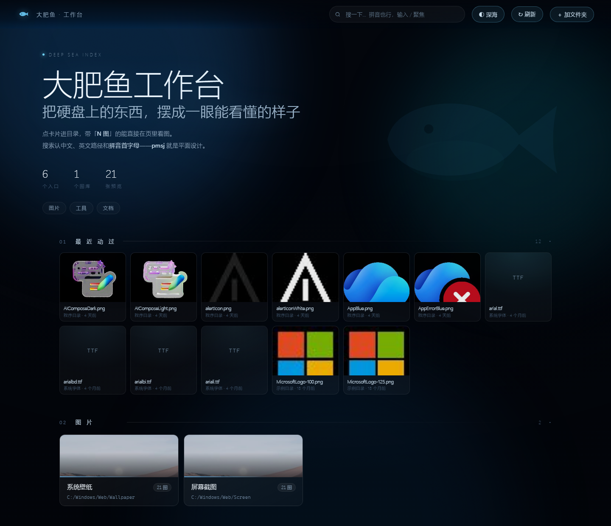

# 大肥鱼工作台

把散落在各个盘里的文件夹，摆成一张**一屏能看完的导航页**：点卡片进目录、图片直接看缩略图、中文和拼音都能搜。生成的是一个**纯静态的 HTML**，双击就能开，不需要装服务器、不上传任何东西。



## 它解决什么问题

硬盘用久了，目录会散成五种分类标准混在一起：有的按软件类型、有的按内容主题、有的按项目、有的按时间、有的按盘符。想找一样东西，得先回忆「我当初把它放哪了」。

这个工具不搬家、不改你的目录结构，只是**在它们上面盖一层索引**：你把常用的目录登记到一份 `folders.json`，它扫一遍，生成一张带缩略图、带搜索、带分组的工作台。

- 一屏看完全部入口，每个入口显示里面有多少项
- 目录里的图片生成本地缩略图，用眼睛找图，不用回忆文件名
- 搜索同时匹配名字、路径、拼音、拼音首字母（`pmsj` → 平面设计）
- 点开任意目录是一个页内的文件浏览器：网格/列表、按名称/时间/大小/类型排序
- 图片在页内放大看，可切换深色/棋盘/浅色背景，方便看带透明通道的 PNG
- 五套配色主题（深海 / 极夜 / 松林 / 冰川 / 纸月）
- 分区可折叠、可改名、可删除、可新建；卡片可换封面

## 需要什么

- Windows 10 / 11（本地小助手是 PowerShell + VBS，仅 Windows）
- Python 3.9 及以上，并安装 Pillow：`pip install pillow`
- Edge 或 Chrome

## 三分钟上手

1. 把仓库下载到任意目录（这个目录以后就是工作台本体，建议放固定位置）
2. `pip install pillow`
3. 双击 `更新工作台.bat` —— 第一次会自动把 `folders.sample.json` 复制成 `folders.json`
4. 用记事本打开 `folders.json`，把示例里的路径改成你自己的目录（见下节）
5. 再双击一次 `更新工作台.bat`
6. 双击生成的 `index.html`，或者把它拖到浏览器里

想放到桌面当入口：给 `index.html` 建个快捷方式就行（右键 → 发送到 → 桌面快捷方式）。

## 配置怎么写

`folders.json` 只有三个键：

```json
{
  "groups": [
    {
      "name": "图 片",
      "py": "tupian",
      "color": "#5fb0e8",
      "cards": [
        { "name": "我的图片", "path": "D:/图片",  "py": "wodetupian", "gallery": "我的图片" },
        { "name": "截图",     "path": "D:/截图",  "py": "jietu",      "gallery": "我的图片" }
      ]
    }
  ],
  "add": [],
  "trash": []
}
```

| 字段 | 说明 |
| --- | --- |
| `groups[].name` | 分区标题，随便起 |
| `groups[].py` | 分区拼音（可留空） |
| `groups[].color` | 左边色条颜色（可留空，自动按顺序取色） |
| `cards[].name` | 卡片上显示的名字 |
| `cards[].path` | 目录绝对路径，正斜杠反斜杠都行 |
| `cards[].py` | 拼音全拼（可留空，留空就只能用中文和路径搜） |
| `cards[].gallery` | 想让这个目录当「图库」（卡片上显示「N 图」徽章）就填一个名字，可留空 |
| `add` / `trash` | 页面里「＋ 加文件夹」和永久隐藏用的，一般不用手写 |

> 路径写自己机器上的真实目录。目录不存在不会报错，卡片会灰着显示「找不到」——这正好用来标记暂时拔掉的移动硬盘。

## 本地小助手（可选）

浏览器不能自己弹资源管理器，也不能重跑 Python，所以附了一个本地小服务做这两件事：

- 大图界面里的「在资源管理器打开」——直接定位到这张图
- 顶栏「↻ 刷新」——在后台重跑一次 `build_workbench.py`，页面自动重载
- 「从电脑里选一张图」当卡片封面

启动：双击 `助手\启动助手.vbs`（静默运行，没有窗口）。停止：双击 `助手\停止助手.bat`。

它只监听 `127.0.0.1:18765`，且要求口令（首次构建时生成的 `助手\token.txt`，页面里嵌的是同一份）。不装也能用，只是上面三个按钮会提示「小助手没在跑」。

想让它开机自启：把 `助手\启动助手.vbs` 的快捷方式丢进
`%APPDATA%\Microsoft\Windows\Start Menu\Programs\Startup`。

> 换了端口要同步改三处：`build_workbench.py` 的 `HELPER_PORT`、`助手\open-folder.ps1` 的 `$port`、`助手\停止助手.bat` 里的 `-LocalPort`。

## 快捷键

| 键 | 作用 |
| --- | --- |
| `/` | 聚焦搜索框 |
| `R` | 重新构建并刷新页面 |
| `T` | 循环切换主题 |
| `Esc` | 关掉当前面板 / 退一层 |
| `←` `→` | 大图里翻上一张 / 下一张 |

## 目录结构

```
build_workbench.py      生成脚本（读配置 → 扫描目录 → 压缩略图 → 写 index.html）
workbench_template.html 页面模板（样式、交互都在这里）
folders.sample.json     示例配置
folders.json            你自己的配置（首次运行生成，不进版本库）
thumbs/                 缩略图缓存（可删，下次重建会重做）
助手/                   本地小服务
index.html              生成物（不进版本库）
```

## 常见问题

**图片都是空白 / 只有一个扩展名？**
缩略图还没生成。第一次扫描大目录会慢（几千张图要一两分钟），之后再跑就是几秒。

**点「↻ 刷新」提示小助手没在跑？**
双击 `助手\启动助手.vbs`。如果提示「还是旧版本」，先 `停止助手.bat` 再启动。

**拼音搜不到？**
`py` 字段留空的卡片只能用中文和路径搜。想要拼音，在配置里补上全拼。

**能给别人用吗？**
这份页面里写的是**你这台机器**的绝对路径，换台机器要重新生成。想分享，分享仓库让别人填自己的 `folders.json`，而不是分享生成好的 `index.html`。

## 协议

代码部分 MIT，见 [LICENSE](LICENSE)。

## 致谢

- 本工具为利用DeepSeek-V4.1-Flash模型制作的vibe coding成果
- 界面图标用的是**大肥鱼**这个开源角色形象，角色创作者：**@ZipZipPipe**、**@这个刀子真甜**。本项目仅把角色形象作为标识使用，版权归两位创作者；如你希望换成别的图标，直接覆盖 `icon.ico` 即可。
- 配色与动效的灵感来自深海与极光，纯 CSS + Canvas 手写，没有引第三方库。
